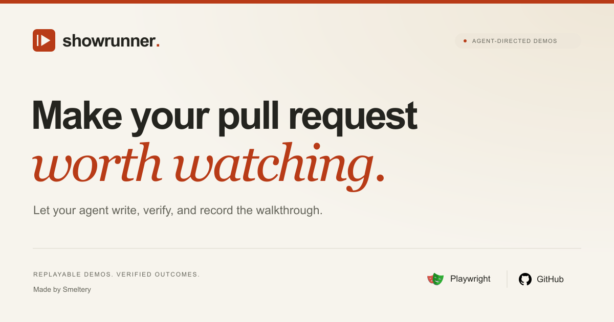

<h1> Showrunner</h1>

[](https://github.com/smeltery/showrunner/actions/workflows/ci.yml)
[](LICENSE)
[](https://www.typescriptlang.org/)
[](https://playwright.dev/)
[](https://nodejs.org/)
[](package.json)
[](tools/docs/package.json)
[](https://flox.dev/)
[](https://github.com/smeltery/showrunner/pkgs/npm/showrunner)

[](https://showrunner-orpin-phi.vercel.app/)

[Website](https://showrunner-orpin-phi.vercel.app/) · [Getting started](https://showrunner-orpin-phi.vercel.app/docs/getting-started/)

**Make your pull request worth watching.**

Showrunner is a website-agnostic Playwright library for replayable pull request demos. A scenario keeps the visible cursor, paced typing, captions, and chapter cards. The application under test keeps authentication, URLs, data setup, and page objects. Playwright records the video.

`@smeltery/showrunner` is a private package on GitHub Packages. It is not on the public npm registry. Install it with a GitHub token that can read packages from `smeltery/showrunner`, or from a local build.

## Let your agent run the demo

Install the [Showrunner skill](skills/showrunner/SKILL.md) directly from the repository:

```sh
npx skills add smeltery/showrunner --skill showrunner
```

Then ask: “Use the showrunner skill to demo this change. Verify the outcome, record the walkthrough, and report the artifacts.”

The agent handles the scenario, verification, and recording using your application's existing setup. The skill and runtime are separate installs; see the [agent workflow](docs/agent-skill.md).

## Manual quick start

Requires [Flox](https://flox.dev/).

```sh
git clone git@github.com:smeltery/showrunner.git
cd showrunner
flox activate
pnpm install
pnpm exec playwright install chromium
pnpm demo
```

## Docs

- [Documentation index](docs/README.md)
- [Getting started](docs/getting-started.md)
- [Usage](docs/usage.md)
- [Presentation API](docs/presentation.md)
- [Pull requests](docs/pull-requests.md)
- [Architecture](docs/architecture.md)
- [Development](docs/development.md)
- [CI](docs/ci.md)
- [Releasing](docs/releasing.md)
- [License](docs/license.md)

## License

[PolyForm Shield License 1.0.0](LICENSE). Copyright (c) 2026 smeltery.
