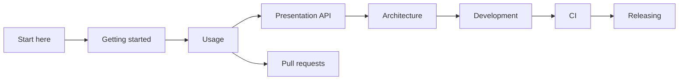

# Documentation

Showrunner documents are split by what you are trying to do.

| Doc                                   | Read it when you want to                          |
| ------------------------------------- | ------------------------------------------------- |
| [Getting started](getting-started.md) | Run the bundled demo                              |
| [Usage](usage.md)                     | Add Showrunner to an application                  |
| [Presentation API](presentation.md)   | Choose cursor, typing, caption, and chapter calls |
| [Pull requests](pull-requests.md)     | Show a reviewer what the change does              |
| [Architecture](architecture.md)       | See how the overlay and fixture fit together      |
| [Development](development.md)         | Work in the Flox environment                      |
| [CI](ci.md)                           | See the checks that gate a change                 |
| [Releasing](releasing.md)             | See how a green `main` becomes a GitHub Release   |
| [License](license.md)                 | Read the PolyForm Shield terms                    |
