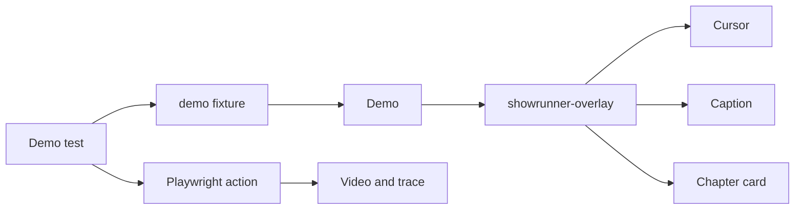

# Architecture

Showrunner is one TypeScript module. It exports a Playwright `test` fixture, `expect`, and the `Demo` class. It does not ship a CLI, a hosted service, or page objects for a particular website.

## Overlay

`install` registers an init script and then paints the overlay on the current document. The init script runs again after a navigation, before application scripts. The host element is `showrunner-overlay`. It covers the viewport, sits at the maximum z-index, and does not receive pointer events.

Inside the shadow root:

- a cursor that follows `mousemove` and flashes on `pointerdown`
- a bottom caption
- a centered chapter card

`ensure` evaluates the same installer in the current document. If the host element is already present, it leaves that overlay and its caption alone.

## Input

`moveTo` scrolls the locator into view and moves the Playwright mouse to the center of its bounding box in 24 steps. The page sees ordinary mouse movement, so the overlay cursor follows it.

`click` moves, then calls `locator.click()`, then holds a short beat. `fill` moves, clears the control, types, then holds a shorter beat. Keyboard input goes through Playwright, so the application receives the same events as a normal test.

## Projects in this repo

| Project        | Directory   | Role                                                     |
| -------------- | ----------- | -------------------------------------------------------- |
| `demo`         | `examples/` | Paced scenario recorded with video and trace             |
| `verification` | `tests/`    | Pace `0` checks for overlay, typing, and action failures |

Consumer repositories should keep their own Playwright config. This repository's config only runs the library's example and verification projects.

## What stays outside

Authentication, base URLs, data setup, cleanup, and page objects stay in the application. Showrunner cannot see those on purpose: a demo toolkit that embeds one product's login flow stops being usable in the next repository.
