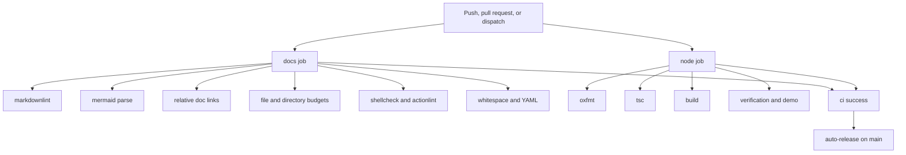

# CI

[`.github/workflows/ci.yml`](../.github/workflows/ci.yml) runs on every pull request, every push to `main`, and `workflow_dispatch`.



## Jobs

| Job            | Runner                         | Checks                                                                |
| -------------- | ------------------------------ | --------------------------------------------------------------------- |
| `docs`         | `blacksmith-2vcpu-ubuntu-2404` | Markdown, Mermaid, links, budgets, shellcheck, actionlint, whitespace |
| `node`         | `blacksmith-4vcpu-ubuntu-2404` | Format, types, build, verification tests, bundled demo                |
| `auto-release` | `blacksmith-2vcpu-ubuntu-2404` | After a green `ci` run on `main`, cut the next patch tag              |
| `release`      | Blacksmith                     | Re-run the gates, pack the tarball, publish, verify assets            |

Both CI jobs start with `step-security/harden-runner` in audit mode, check out the repository, install Flox, and run `flox activate`. Third-party actions are pinned to a commit SHA. Concurrency cancels an older run for the same ref. `ci` has read-only contents permission.

The workflow name is `ci`. [auto-release.yml](../.github/workflows/auto-release.yml) listens for that name. See [Releasing](releasing.md).

## Local equivalent

```sh
flox activate
bash scripts/check-docs.sh
bash scripts/check-hygiene.sh
bash scripts/check-whitespace.sh
bash scripts/check-node.sh
```

Pre-commit runs those checks before a commit, except the whitespace hook, which runs as the individual pre-commit hooks listed in [Development](development.md).
