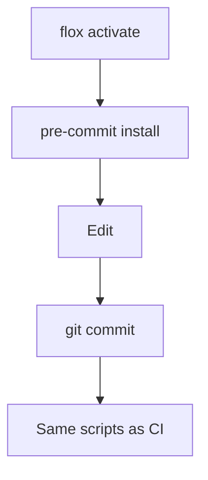

# Development

Work inside Flox. The environment manifest is [`.flox/env/manifest.toml`](../.flox/env/manifest.toml). Activation prepares pnpm 10.13.1 and installs the pre-commit hook when you are not in CI.

## Commands

| Command                 | What it checks                                   |
| ----------------------- | ------------------------------------------------ |
| `pnpm fmt`              | Format the repository                            |
| `pnpm fmt:check`        | Format check                                     |
| `pnpm type-check`       | TypeScript                                       |
| `pnpm build`            | Emit `dist/`                                     |
| `pnpm test:agent`       | Verification project, pace 0                     |
| `pnpm demo`             | Bundled scenario with video and trace            |
| `pnpm check:docs`       | Markdown, Mermaid, and relative doc links        |
| `pnpm check:hygiene`    | File budgets, shellcheck, and actionlint         |
| `pnpm check:whitespace` | Trailing whitespace, YAML, and merge markers     |
| `pnpm check:node`       | Format, types, build, verification, and the demo |

Bun runs the documentation checks in [`tools/docs`](../tools/docs/package.json). pnpm runs the library. Playwright downloads Chromium into the user cache; CI adds the Ubuntu libraries with `playwright install --with-deps`.

## Hooks

[`.pre-commit-config.yaml`](../.pre-commit-config.yaml) calls the same scripts as CI, wrapped in `flox activate`:

- `scripts/check-docs.sh`
- `scripts/check-hygiene.sh`
- `scripts/check-node.sh`
- trailing whitespace, newlines, merge conflicts, YAML, JSON, and large files

Install the hook with `pre-commit install` if you activated the environment before this clone had a `.git` directory. `flox activate` runs that install for local shells.

## After a change

Run `pnpm build`, `pnpm type-check`, `pnpm test:agent`, and `pnpm fmt:check`. The commit hook runs those gates plus the docs checks. Do not commit `test-results/`, videos, traces, or credentials.
