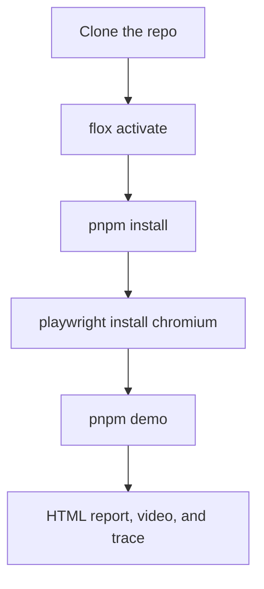

# Getting started

The bundled release-checklist demo is self-contained. After installation it needs no server, account, or network.



## Run the first take

```sh
flox activate
pnpm install
pnpm exec playwright install chromium
pnpm demo
pnpm exec playwright show-report
```

`flox activate` is the supported environment. It selects Node.js 22 and pnpm 10.13.1, and it installs the git hooks that mirror CI.

Add `--headed` to watch the demo live:

```sh
pnpm demo -- --headed
```

To use an installed Chrome channel instead of the downloaded Chromium build:

```sh
SHOWRUNNER_BROWSER_CHANNEL=chrome pnpm demo
```

The same variable works with `pnpm test:agent`.

Recordings and traces appear in `test-results/` and the HTML report. Generated media stays out of Git.

## What a pass means

The bundled scenario replaces a draft task and asserts that the list contains exactly one item with the typed text.

A pass does not prove backend persistence, authentication, multi-user behavior, or anything about your application. Those belong in the application repository. See [Usage](usage.md).
