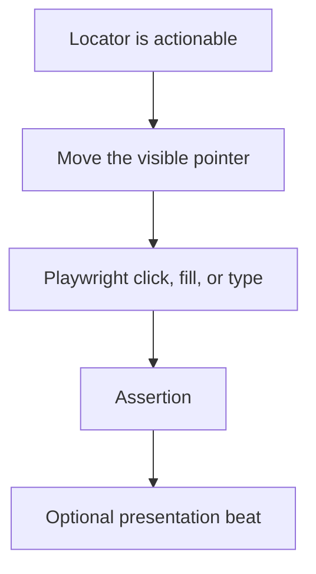

# Presentation API

`test` from `@smeltery/showrunner` adds a `demo` fixture. `expect` is the Playwright expect. Presentation delays pace the recording. They do not wait for the application. Use locators, actionability, and assertions for readiness.

## Pace

`test.use({ demoOptions: { pace: 0 } })` disables presentation delays. The default pace is `1`. A pace of `2` doubles them. Pace must be a finite number greater than or equal to zero.

Verification tests in this repository use pace `0`. The bundled demo uses the default.

## Methods

| Method                                           | Behavior                                                           |
| ------------------------------------------------ | ------------------------------------------------------------------ |
| `demo.click(locator)`                            | Move the pointer, click, then pause                                |
| `demo.fill(locator, text)`                       | Clear the control, type at a readable pace, then pause             |
| `demo.typeHuman(locator, text)`                  | Append characters with Playwright keyboard input                   |
| `demo.moveTo(locator)`                           | Scroll the target into view and move the pointer to its center     |
| `demo.caption(text)`                             | Show a non-interactive caption at the bottom                       |
| `demo.clearCaption()`                            | Remove the caption                                                 |
| `demo.interstitial(title, body?, milliseconds?)` | Show a chapter card, pause, then remove it                         |
| `demo.beat(milliseconds?)`                       | Pause for presentation. The default is 700 ms, multiplied by pace  |
| `demo.ensure()`                                  | Restore the overlay after the document content is replaced         |
| `demo.install()`                                 | Install the overlay for the current page and for later navigations |

`click` still uses Playwright's click, so a disabled or hidden control fails the action. `fill` clears with `locator.fill("")` and then types. `typeHuman` uses `pressSequentially` with a per-character delay of 45 ms multiplied by pace.

`moveTo` requires a locator from the same page and a visible bounding box.

## Captions and chapters

Caption and chapter text is inserted as text, so markup is shown literally. The overlay is `aria-hidden` and ignores pointer events. Its styles live in a shadow root, separate from the page.

A normal navigation builds a fresh overlay, so the previous caption is gone. `setContent` and similar replacements do not navigate. Call `demo.ensure()` after those when the overlay node was removed. Actions call `ensure()` before they draw.

`interstitial` clears the caption, shows the title and optional body, waits, then hides the chapter card. The default chapter hold is 2200 ms before pace is applied.
