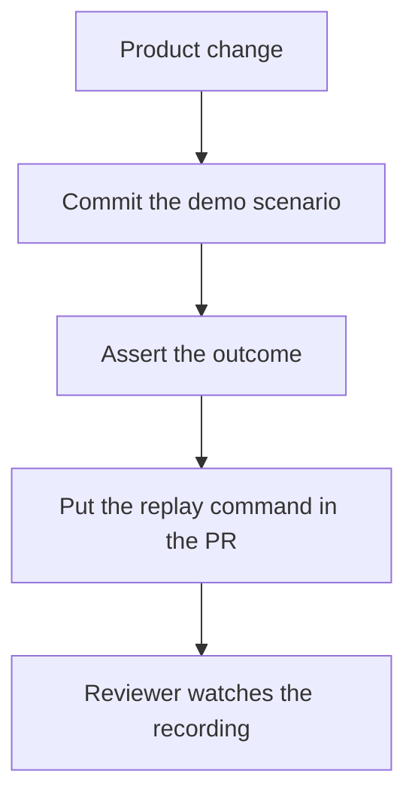

# Pull requests

A demo scenario is part of the product change. The recording helps a reviewer see the behavior. The assertion is what makes the scenario a test.



## What to include

1. Commit a `*.demo.ts` scenario with the product change.
2. Seed and authenticate quickly. Use `demo` for the behavior a reviewer should watch.
3. Assert the intended outcome. A recording alone does not establish correctness.
4. In the pull request, include the replay command, what a pass demonstrates, what to watch beyond the exit status, and what a pass does not prove.
5. Attach a video when the review platform supports it. Do not commit videos, traces, or credentials.

The repository template is [`.github/pull_request_template.md`](../.github/pull_request_template.md).

## Bundled demo

- Command: `pnpm demo`
- A pass demonstrates that replacing the draft creates exactly one checklist item with the entered text.
- Watch for a readable cursor, captions, and typing. The original draft must not remain in the field or the list.
- A pass does not prove backend persistence, authentication, multi-user behavior, or integration with your application.

Demos run on demand. This repository does not upload recordings or comment on pull requests. An application can add its own workflow with its own environment and artifact policy.

## Sharing a video

Playwright records WebM. For an MP4, use a locally installed ffmpeg:

```sh
ffmpeg -i test-results/<scenario>/video.webm -c:v libx264 -pix_fmt yuv420p -movflags +faststart demo.mp4
```

Automatic trimming, voiceover, and video editing are outside this library.
