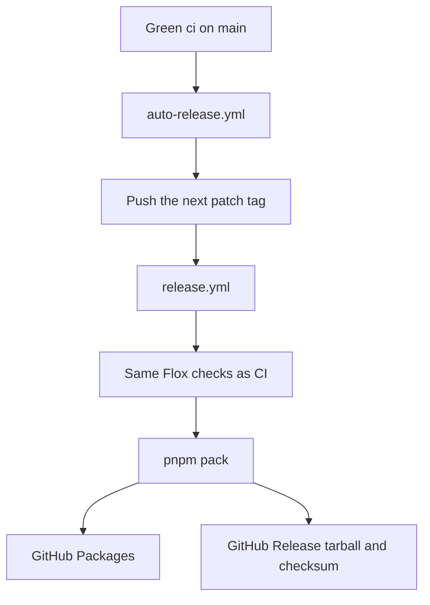

# Releasing

The git tag is the version. A successful `ci` run on `main` cuts the next patch tag and dispatches the release build. [`.github/workflows/auto-release.yml`](../.github/workflows/auto-release.yml) is the Showrunner copy of the `smeltery/hab` auto-release workflow.



## What happens

1. Merge to `main`.
2. Wait for `ci` to pass.
3. `auto-release.yml` does nothing when that commit already has a `vMAJOR.MINOR.PATCH` tag.
4. Otherwise it increments the latest patch tag, starting at `v0.1.0` when no release tag exists, pushes the tag, and runs `release.yml` with that tag.
5. [`.github/workflows/release.yml`](../.github/workflows/release.yml) checks that the tag points at `origin/main`, runs the Flox checks, sets the packed package version from the tag, publishes `@smeltery/showrunner` to GitHub Packages, and uploads `showrunner-<version>.tgz` plus `SHA256SUMS`.

`package.json` in Git stays the baseline. The published version comes from the tag. The package is public on GitHub Packages, not npmjs.com. Registry visibility is configured separately from repository visibility. Public GitHub Releases also include a tarball that can be downloaded without registry authentication. A version that is already on the registry is left as-is.

A tag you push yourself also starts `release.yml`. A tag pushed by `GITHUB_TOKEN` does not, which is why auto-release dispatches the workflow after it pushes.

## Manual tag

```sh
git tag v0.1.0
git push origin v0.1.0
```

## If the release build fails

Delete the tag, fix `main`, and let the next green `ci` run cut a new tag:

```sh
git push --delete origin v0.1.0
git tag -d v0.1.0
```

No release asset is published until the workflow succeeds.
