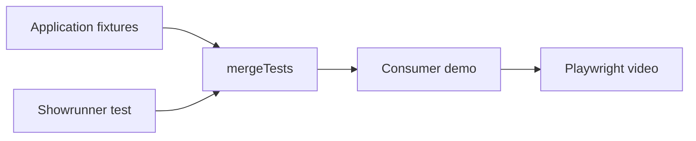

# Usage

Build this package, then install it next to `@playwright/test` in the application that owns the product behavior.



## Install

The source and [release downloads](https://github.com/smeltery/showrunner/releases) are public. Release tarballs and local builds do not require registry authentication.

From GitHub Packages (requires an authenticated token with `read:packages` and access to the package, even when package visibility is public):

```sh
npm config set @smeltery:registry https://npm.pkg.github.com
npm config set //npm.pkg.github.com/:_authToken "$(gh auth token)"
pnpm add -D @smeltery/showrunner
```

From a local checkout:

```sh
cd ~/Code/github.com/smeltery/showrunner
flox activate
pnpm build
cd /path/to/your/app
pnpm add -D @playwright/test /absolute/path/to/showrunner
```

From a public GitHub Release tarball (example pinned to `v0.1.5`; choose the version you want from the release page):

```sh
curl -fLO https://github.com/smeltery/showrunner/releases/download/v0.1.5/showrunner-0.1.5.tgz
curl -fLO https://github.com/smeltery/showrunner/releases/download/v0.1.5/SHA256SUMS
shasum -a 256 -c SHA256SUMS
pnpm add -D @playwright/test ./showrunner-0.1.5.tgz
```

`@playwright/test` 1.63.0 or newer is a peer dependency. Showrunner does not start your application, seed data, or sign in.

## Demo config

Create `playwright.demo.config.ts`:

```ts
import { defineConfig } from "@playwright/test";

export default defineConfig({
	testDir: "./demos",
	testMatch: "**/*.demo.ts",
	reporter: [["list"], ["html", { open: "never" }]],
	use: {
		baseURL: process.env.DEMO_BASE_URL ?? "http://localhost:3000",
		viewport: { width: 1280, height: 720 },
		video: "on",
		trace: "on",
	},
});
```

Create `demos/profile.demo.ts` and adapt the route and accessible names:

```ts
import { test, expect } from "@smeltery/showrunner";

test("should save a new display name", async ({ page, demo }) => {
	await page.goto("/settings/profile");
	await demo.caption("Update your display name");
	await demo.fill(page.getByRole("textbox", { name: "Display name" }), "River");
	await demo.click(page.getByRole("button", { name: "Save" }));
	await expect(page.getByRole("status")).toHaveText("Profile saved");
	await demo.beat();
});
```

Run it against the application:

```sh
DEMO_BASE_URL=http://localhost:3000 pnpm exec playwright test --config=playwright.demo.config.ts --headed
```

## Your fixtures

`mergeTests` composes the demo fixture with application fixtures:

```ts
import { mergeTests } from "@playwright/test";
import { test as demoTest } from "@smeltery/showrunner";
import { test as appTest } from "./app-fixtures.js";

export const test = mergeTests(appTest, demoTest);
```

For a popup or another `Page`, construct `new Demo(page)` and `await demo.install()`. The fixture does that for the test's main page.

Configure Playwright `storageState` or a setup project as usual. Use disposable data, restore changes after the scenario, and keep authentication files and recordings out of Git.

The calls on `demo` are listed in [Presentation API](presentation.md). How to describe the replay in a pull request is in [Pull requests](pull-requests.md).
